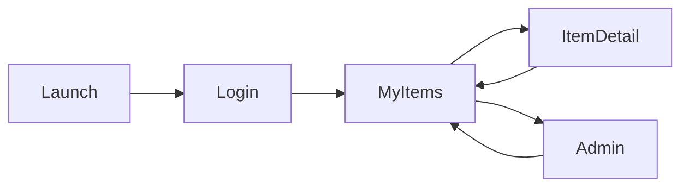

# Android App UI Setup

The Android app is written in Kotlin with Jetpack Compose. It is a small client that shows the API working end to end, so it only has the four screens the project asks for.

## Screens

1. Login
   The landing screen. The user signs in with Google using the Authorization Code flow with PKCE. After signing in they go to My Items.

2. My Items
   The home screen. Shows the user's registered food items (RegistryItem). The list is paginated and loads the next page when you scroll to the bottom. Items that have recalled foods linked to them are marked as recalled, and the first one is shown in a recall alert at the top. The menu on this screen has Sign out and Delete my account.

3. Item Detail
   One screen used to view, edit, and create an item. In view mode it shows the product, batch, and any recalls linked to the item (contaminant, recall date, manufacture date, batch). In edit and create mode the user can change the product and batch. Product is required and batch is optional.

4. Admin
   Only shown to admins. Lists all users, lets an admin turn the admin role on or off, and delete a user.

## Navigation

If any request returns 401, the app goes back to Login.

## Planned API calls

These follow docs/openapi.yaml.

- GET /api/v1/users/me to know if the user is an admin
- GET /api/v1/registry?page=0&size=20 for the My Items list
- GET /api/v1/registry/{itemId} for the detail screen, including the recalledFoods list
- POST /api/v1/registry to add an item
- PUT /api/v1/registry/{itemId} to edit an item
- DELETE /api/v1/registry/{itemId} to remove an item
- GET /api/v1/recalls/{recallId} to show one recall in full
- GET /api/v1/users, PATCH /api/v1/users/{userId}, DELETE /api/v1/users/{userId} for the admin screen

Every request sends the Google ID token in the Authorization header as a Bearer token.

## Error handling

The app never shows a blank screen when something fails.

- 401 shows a message that the session expired and a button to sign in again
- 403 shows that the user does not have permission
- 404 shows that the item was not found
- 400 shows the detail message from the API error body above the form
- 500 and network errors show a message and a Try again button

## Code structure

We use MVVM. Screens are UI only and get their data through parameters, so they can be built and previewed before the logic exists. Each screen gets a ViewModel that loads the data and passes it in.

- ui/theme: colors, fonts, and shapes
- ui/login: login screen
- ui/items: My Items screen
- data: API models, Retrofit interface, repository, error mapping (added with the logic)
- auth: Google sign in with AppAuth (added in Sprint 2)

Libraries: Retrofit and OkHttp for HTTP, kotlinx serialization for JSON, AppAuth for PKCE, navigation compose for moving between screens.

## Look and feel

We kept the styling simple and close to a government food safety site. Light gray background with white cards, a blue header and main buttons in navy, red for recall alerts and the RECALLED tag, and a small gold mark next to the app name. Headlines use a narrow bold font and corners are mostly square.

## Running locally

- On the emulator the API on your computer is at http://10.0.2.2:8080/
- Plain HTTP is only allowed for 10.0.2.2. The deployed API uses HTTPS.
- The Google client ID and the API URL go in local.properties, which is not committed.

## Tests

- ViewModel tests for loading, paging, and error states
- MockWebServer tests that check the request path, the Authorization header, the JSON mapping, and 401 and 500 responses
- One Compose UI test for the My Items screen